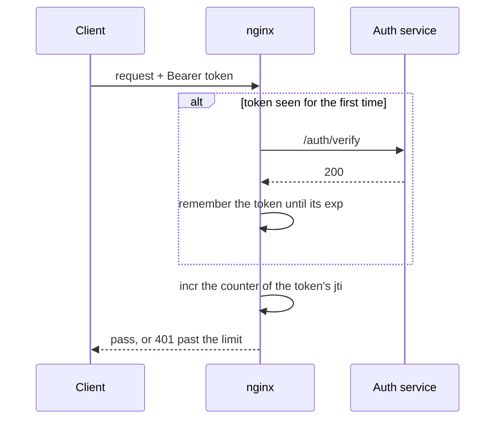

# Puzzle auth for nginx (OpenResty)

The nginx side of the [auth service](../README.md): Lua that checks the JWT
token of a request, so that the auth service is asked once per token and not
once per request. Shared by eth-rpc-proxy, nft-proxy and market-proxy.

```
auth/nginx/
├── conf/auth_locations.conf     # /auth/, /_auth_token, /_auth_go_verify
├── lua/auth/
│   ├── auth_token_validator.lua # content handler of /_auth_token
│   ├── token_limit.lua          # the answer for a usage count
│   ├── jwt_claims.lua           # jti and exp of a verified token
│   └── auth_config.lua          # limits, auth service address
├── lua/utils/
│   ├── auth_utils.lua           # token from the header or the query string
│   └── resolver_utils.lua       # DNS lookup in Lua
└── lua_tests/                   # busted
```

## How a token is checked



- **Once per token.** A verified token is remembered in the `jwt_tokens`
  shared dict until its `exp`. Later requests do not reach the auth service
  and keep working while it is down.
- **Counted per `jti`.** The counter belongs to the token id, not to the token
  string, and is taken with one atomic `incr`. Past `requests_per_token` the
  answer is `401`; the client is expected to solve a new puzzle.
- **An auth service failure is not a bad token.** A 5xx or a timeout on verify
  (2s to connect, 5s to answer) is passed on as a server error. A `401` would
  make the client throw a good token away.
- **In memory of one nginx.** With several nginx replicas the limit applies
  per replica.

## Using it

Copy `lua/` next to the proxy's own Lua and `conf/auth_locations.conf` into
the nginx conf directory, e.g. in the proxy's Dockerfile (build context: the
repository root, `proxy-common` being a submodule):

```dockerfile
COPY proxy-common/auth/nginx/lua /usr/local/openresty/nginx/lua
COPY proxy-common/auth/nginx/conf/auth_locations.conf /usr/local/openresty/nginx/conf/
RUN opm install ledgetech/lua-resty-http
```

```nginx
env GO_AUTH_SERVICE_URL;
env AUTH_CONFIG_FILE;
env CUSTOM_DNS;
env AUTH_RESOLVE_INTERVAL;
env AUTH_ACCEPT_QUERY_TOKEN;

http {
    lua_package_path "/usr/local/openresty/nginx/lua/?.lua;/usr/local/openresty/lualib/?.lua;;";
    lua_shared_dict jwt_tokens 10m;

    init_worker_by_lua_block {
        require("auth.auth_config").init()
    }

    server {
        include auth_locations.conf;

        location / {
            # A token, or basic auth
            satisfy any;
            auth_basic           "Restricted";
            auth_basic_user_file /etc/nginx/.htpasswd;
            auth_request         /_auth_token;

            proxy_pass http://backend;
        }
    }
}
```

## Configuration

| Variable | Default | Meaning |
|----------|---------|---------|
| `GO_AUTH_SERVICE_URL` | `http://auth-service:8081` | Auth service address |
| `CUSTOM_DNS` | `127.0.0.11` (Docker) | DNS server the address is resolved with |
| `AUTH_RESOLVE_INTERVAL` | `30` | Seconds between lookups of the address |
| `AUTH_CONFIG_FILE` | `/app/auth_config.json` | The file the auth service runs with; `requests_per_token` and `token_expiry_minutes` are read from it |
| `AUTH_ACCEPT_QUERY_TOKEN` | accepted | `false` refuses a token in `?token=`, `?jwt=` or `?access_token=` and takes it from `Authorization: Bearer` only |

The auth service address is resolved in Lua, when a worker starts and every
`AUTH_RESOLVE_INTERVAL` seconds after that, and nginx proxies to the IP. So an
auth service that starts after nginx, or comes back with another IP, is found
without restarting nginx. A lookup that fails keeps the last IP found. nginx's
own `resolver` is deliberately not involved.

Switch `AUTH_ACCEPT_QUERY_TOKEN` off in a proxy that passes the query string
on or caches by it: a query token stays in the query string of the request
after it is checked, so it would reach the backend and end up in cache keys.

## Tests

```bash
luarocks install busted
luarocks install lua-cjson
./lua_tests/run_busted_tests.sh
```
